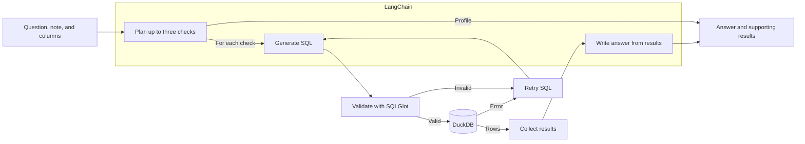

# DataPilot

I built DataPilot to explore CSV and Excel files without writing SQL by hand. You can upload a dataset, look through its columns and preview, and ask questions in plain language. Each answer has its own page with the SQL and data used to produce it.

## What it does

- Loads CSV files and Excel workbooks with multiple sheets.
- Shows detected column types, missing values, distinct counts, and a 10-row preview.
- Lets you add a short note about the dataset, such as units or column definitions.
- Plans a question using the column information saved during upload. For broader questions, it can run several checks.
- Shows the answer, supporting rows, executed SQL, and a step-by-step activity log.

## How it works

The frontend is built with React, TypeScript, and Vite. FastAPI handles uploads and questions. DuckDB stores each uploaded dataset in a temporary local workspace.

When you ask a question, the backend reads the saved column profile, uses LangChain to plan the analysis and generate SQL, checks the SQL, runs it in DuckDB, and builds an answer from the returned rows. The SQL checks use SQLGlot. More detail is in [the architecture guide](docs/architecture.md).



## SQL safety

Generated SQL has to be a single `SELECT` query against the selected table. The app rejects other tables, writes, external readers, and unsupported functions. Queries use a read-only DuckDB connection with external access disabled. Time, row, and response-size limits keep results bounded. Uploaded files are stored in separate temporary workspaces that expire after 60 minutes of inactivity.

This project is set up for local use. Keep workspace IDs and uploaded data private.

## Run it locally

You need [uv](https://docs.astral.sh/uv/getting-started/installation/) with Python 3.12, Node.js 20.19+ (20.x) or 22.12+, and npm. uv can install Python 3.12 if needed. The `uv.lock` and `package-lock.json` files make installs repeatable.

From the project root, create `.env` if you do not already have one:

```bash
cp .env.example .env
```

The question feature supports two model providers. Set these values in the **root** `.env` file:

- **OpenAI:** Keep `LLM_PROVIDER=openai`, add `OPENAI_API_KEY`, and optionally change `ANALYSIS_MODEL`.
- **Local Ollama:** Install and start [Ollama](https://docs.ollama.com/api/introduction), download a model, then set `LLM_PROVIDER=ollama` and `OLLAMA_MODEL` to the exact tag shown by `ollama list`. The default `OLLAMA_BASE_URL` is `http://localhost:11434/v1`; `OLLAMA_TIMEOUT_SECONDS` controls how long one model call may take. An OpenAI key is not needed for this option.

Both options use the same SQL validation and query limits. Ollama is accessed through its local OpenAI-compatible endpoint, so the Python dependency lockfile is the same for both providers.

For example, after Ollama is running:

```bash
ollama pull llama3.2
```

Set `LLM_PROVIDER=ollama` and `OLLAMA_MODEL=llama3.2` in `.env`. This is a setup example; you can use another downloaded model tag.

Start the backend in one terminal:

```bash
cd backend
uv sync --locked --python 3.12
uv run --locked uvicorn app.main:app --reload
```

Start the frontend in another terminal, from the project root:

```bash
cd frontend
npm ci
npm run dev
```

Open the URL printed by Vite, usually `http://localhost:5173`. Try **Try the sample dataset**, or upload [the sample CSV](samples/orders.csv) or [the sample workbook](samples/orders_workbook.xlsx). The API health check is at `http://localhost:8000/api/health` and the API docs are at `http://localhost:8000/docs`.

## Run the checks

From the project root:

```bash
cd backend
uv run --locked pytest -q
uv run --locked ruff check .
uv run --locked ruff format --check .
```

Then:

```bash
cd ../frontend
npm test
npm run lint
npm run build
```

The backend tests cover uploads, SQL validation, retries, and reports. They run without an API key. The [API reference](docs/api.md) lists the endpoints and limits.

## License

DataPilot is available under the [MIT License](LICENSE). You can use, modify, and distribute the project, including for commercial purposes, as long as you include the license and copyright notice. The license is provided without warranty.
